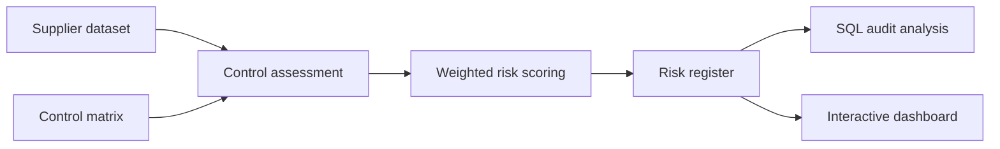

<div align="center">

# SUPPLY CHAIN GOVERNANCE
### Supplier Risk Intelligence & Internal Control Monitoring

   

*Transforming supplier data into actionable governance decisions.*

</div>

---

## Executive overview

A portfolio project demonstrating third-party risk management, procurement governance, control monitoring and risk-based escalation across a simulated global supplier portfolio.

| Suppliers assessed | Annual spend monitored | High-risk suppliers | Suppliers passing all controls |
| :---: | :---: | :---: | :---: |
| **100** | **$24.99M** | **29** | **29%** |

### Risk distribution

| Tier | Suppliers | Distribution |
|---|---:|---|
| Low | 55 | 🟩🟩🟩🟩🟩🟩 |
| Moderate | 16 | 🟨🟨 |
| High | 29 | 🟥🟥🟥 |

71 suppliers have at least one control exception. Figures are calculated from the synthetic dataset and illustrative scoring policy, not actual business outcomes.

## Governance methodology

| Control domain | Weight | Accountable function |
|---|---:|---|
| Regulatory | 25% | Compliance |
| Financial | 20% | Finance |
| Operational | 15% | Supply Chain |
| Contract | 15% | Legal |
| ESG | 10% | Sustainability |
| Cybersecurity | 10% | IT Security |
| Concentration | 5% | Procurement |

Each control is binary: 0 = pass, 1 = exception. Weighted exceptions produce a score from 0 to 100. High risk: score ≥40 or any regulatory exception; moderate: 20–39 without regulatory exception; low: below 20 without regulatory exception. A low-risk supplier may still have exceptions.

| Tier | Proposed escalation |
|---|---|
| High | Refer to governance committee; review approval and remediation within 5 business days |
| Moderate | Assign control owner; review remediation within 30 days |
| Low | Monitor and resolve exceptions through routine review |

The policy is illustrative and informed by general risk management and sustainable procurement concepts (ISO 31000 and ISO 20400); it does not establish certification or legal compliance.

## Analytics workflow



## Run locally

```bash
git clone https://github.com/kayarihub/Supply-Chain-Governance.git
cd Supply-Chain-Governance
python -m pip install -r requirements.txt
python risk_assessment.py
streamlit run dashboard.py
```

Optional SQLite CLI analysis: `sqlite3 :memory: < governance_analysis.sql`.

## Repository guide

| File | Purpose |
|---|---|
| [Supplier dataset](data/suppliers.csv) | 100 synthetic supplier records |
| [Control matrix](data/control_matrix.csv) | Risk weights, owners and corrective actions |
| [Python assessment](risk_assessment.py) | Scoring and risk register generation |
| [SQL analysis](governance_analysis.sql) | Spend exposure and exception analysis |
| [Dashboard](dashboard.py) | Interactive category filters, KPIs and CSV export |

## Business value

- Prioritize supplier reviews using consistent, explainable risk criteria.
- Identify control exceptions and assign corrective actions.
- Support audit preparation through reproducible assessments.
- Monitor procurement spend exposure and third-party risk.

## Limitations

Synthetic binary indicators are not verified evidence. Weights and thresholds are illustrative rather than empirically calibrated. This prototype does not include live ERP integrations, evidence validation, authentication or a remediation approval workflow.

---

<div align="center">

**Procurement Analytics · Governance · Risk & Compliance · Business Intelligence**

</div>
